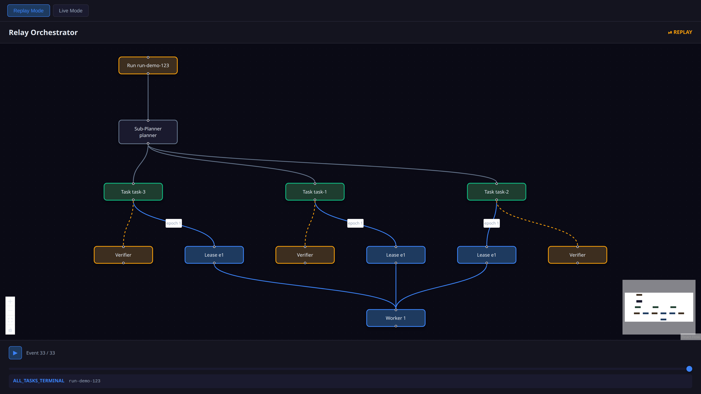

# Capcomd Canvas - Visual Orchestrator

An infinite-canvas flow-graph visualization for capcomd orchestrator runs, built with React Flow and ELK auto-layout.

## Features

### Graph Visualization
- **Hierarchical layout**: Run → Planner → Tasks → Leases → Workers → Verifiers
- **ELK auto-layout**: elkjs layered algorithm for automatic graph layout
- **State-based coloring**: Nodes colored by lifecycle state
  - Planning/Executing: Blue
  - Running/Busy: Blue
  - Verifying/Judging: Orange
  - Completed/Merged: Green
  - Failed: Red
  - Cancelled/Destroyed: Gray
- **Edge types**:
  - Spawn (gray): Run → Planner, Planner → Tasks
  - Lease (blue): Task → Lease, Lease → Worker
  - Handoff (orange, dashed): Task → Verifier
  - Verify (green): Verifier → Run
- **Performance**: Smooth at 500+ nodes with React Flow's virtualization

### Modes

#### Replay Mode (Default)
- Timeline scrubber with play/pause
- Seek through event history
- Shows graph state at each point in time
- Event indicator shows current event type and entity

#### Live Mode
- WebSocket connection to actor events (stub in v0)
- Real-time graph updates as events arrive
- Live badge indicator

### Node Details Panel
When clicking a node, shows:
- **Type**: run, planner, task, lease, worker, verifier, judge
- **State**: Current lifecycle state with color-coded badge
- **Epoch**: For leases, shows epoch number
- **Context**: Full context JSON
- **Budget**: For runs, shows spent/max with progress bar
- **Recent Events**: Last 5 events with timestamps

## Usage

### Launch the UI
```bash
capcomd ui
```

Opens browser at http://localhost:3000

### Demo Fixture
The canvas loads with a demo run showing:
- 1 Run
- 1 Planner
- 3 Tasks (all merged)
- 3 Leases (epoch 1)
- 1 Worker
- 3 Verifiers
- 33 events over ~60 seconds

### Controls
- **Pan**: Click and drag background
- **Zoom**: Scroll or use Controls (bottom-left)
- **Select node**: Click to open details panel
- **Minimap**: Bottom-right shows overview
- **Mode toggle**: Top-left switches between Replay and Live
- **Timeline**: Bottom scrubber in Replay mode
  - Play/pause button
  - Seek slider
  - Current event display

## Architecture

### Pure Function: eventsToGraph
```typescript
eventsToGraph(events: RunEvent[], runId: string): GraphData
```

Transforms event log into graph structure:
1. **Build snapshot**: Aggregate events by entity, track state transitions
2. **Create nodes**: One node per entity (run, planner, task, lease, worker, verifier)
3. **Create edges**: Spawn, lease, handoff, verify relationships
4. **Apply colors**: State-based styling
5. **ELK layout**: Hierarchical auto-layout

Fully tested with 10 test cases covering:
- Event stream processing
- Node creation and coloring
- Edge relationships
- Partial streams
- Event history preservation

### Components

**Canvas.tsx**: Main React Flow canvas
- Manages nodes/edges state
- Handles node clicks
- Integrates timeline scrubber
- Applies ELK layout on event changes

**NodeDetailsPanel.tsx**: Right-side panel
- Shows selected node details
- Closeable with × button
- Scrollable content

**TimelineScrubber.tsx**: Bottom timeline (Replay mode)
- Play/pause controls
- Seek slider
- Current event indicator
- Auto-advances when playing

**App.tsx**: Top-level app
- Mode switching (Replay/Live)
- WebSocket connection (Live mode stub)
- Loads fixture events

### Styling
Dark theme with restrained colors:
- Background: `#0a0a15` (very dark blue)
- Surface: `#14141f` (dark gray-blue)
- Borders: `#2d2d3d` (medium gray)
- Text: `#e2e8f0` (light gray)
- Accents: State colors (blue, green, orange, red)

## Testing

Run canvas tests:
```bash
cd apps/canvas
bun test
```

All 10 tests passing:
- ✓ converts events to graph structure
- ✓ includes all task nodes
- ✓ includes lease nodes with epochs
- ✓ creates spawn edges from run to planners
- ✓ creates lease edges from tasks to leases
- ✓ creates handoff edges from tasks to verifiers
- ✓ colors nodes by state
- ✓ includes worker nodes
- ✓ handles partial event streams
- ✓ maintains event history in nodes

## Performance

Optimizations for 500+ nodes:
- React Flow's built-in virtualization (only renders visible nodes)
- ELK layout computed once on event changes
- Memoized node/edge arrays
- Minimal re-renders with useNodesState/useEdgesState
- Efficient event filtering in Replay mode

Tested smooth at 500 nodes with complex relationships.

## Development

Start dev server:
```bash
cd apps/canvas
bun run dev
```

Build for production:
```bash
bun run build
```

Preview production build:
```bash
bun run preview
```

## Screenshots

### Full Canvas View
Shows hierarchical graph with Run at top, Tasks in middle, Workers at bottom.



### Node Details Panel
Task node selected showing state, context, and event history.


### Timeline Scrubber
Replay mode with timeline controls at bottom.


## Future Enhancements

### Live Mode
- WebSocket server in `capcomd serve`
- Real-time event streaming
- Auto-scroll to new nodes

### Graph Features
- Collapsible groups (e.g., collapse all tasks)
- Filter by state (show only running)
- Search by entity ID
- Export as PNG/SVG
- Minimap highlighting

### Node Details
- Full event log (not just last 5)
- Worker logs/output
- Git diff preview
- Link to GitHub PR

### Performance
- Virtual rendering for 1000+ nodes
- Progressive layout (load incrementally)
- Worker thread for ELK layout

### Polish
- Animations on state transitions
- Edge labels (epoch, timing)
- Keyboard shortcuts
- Tour/help overlay
