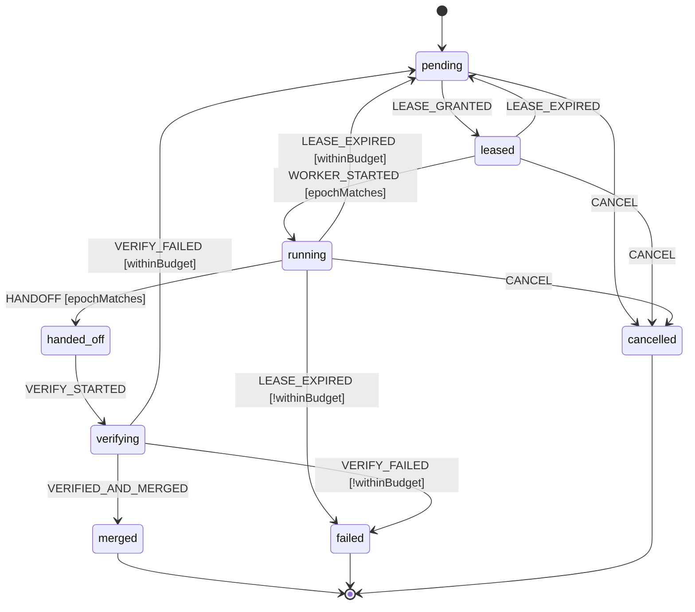
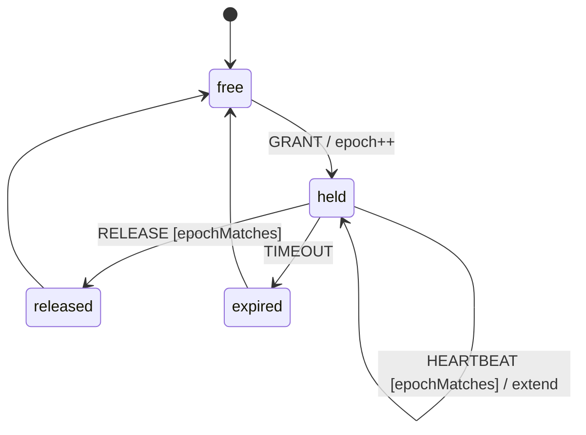
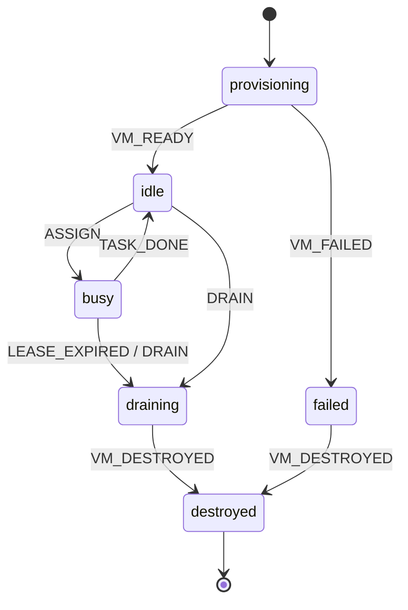
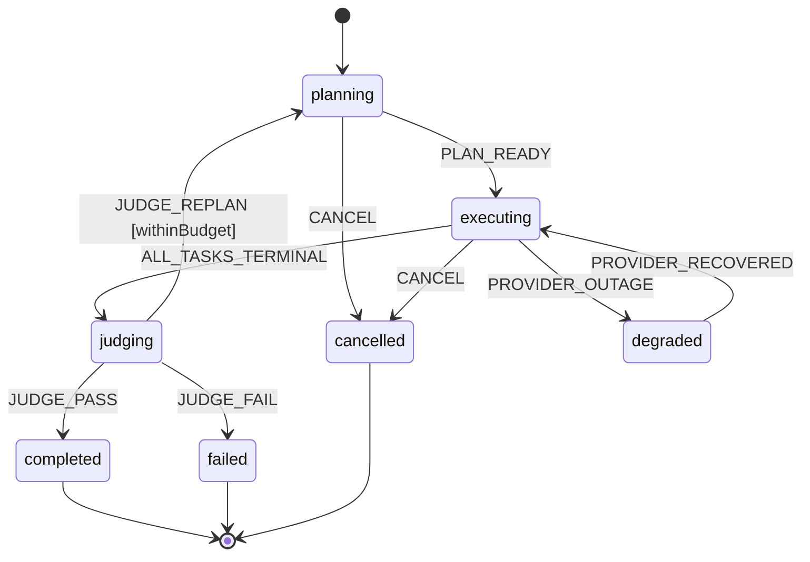

# ADR-008: Explicit lifecycle state machines (XState v5 pure transitions, Rivet-persisted)
> Reconstruction: **MEDIUM confidence.** The decision, structure, verified API facts, Bun results and the 2026-10-17 amendment are from my context. The original prose and exact diagram edges were not retained verbatim; the Mermaid diagrams below are a faithful re-derivation of the agreed states, but transition names may differ from the original.

Status: Accepted. Date: 2026-10-16.

## Context
relay coordinates tasks, leases, workers and runs across crashes (actors-v1.md, ADR-002). Lifecycle bugs (double merge, zombie leases) are the main correctness risk.

## Decision
- Explicit state machines **only for lifecycles**: task, lease, worker, run (merge possibly later).
- The **Rivet actor owns and persists state**. XState v5 is used only as **pure transition logic**: `initialTransition(machine, input?)` and `transition(machine, snapshot, event)` → `[snapshot, actions]`. No interpreter, no timers, no spawned actors. Timers are Rivet `c.schedule`. [Doc: https://stately.ai/docs/pure-transitions]
- Persist `{state, context, version}` **together with the triggering event, atomically**, in actor SQLite (`c.db`):
  - `lifecycle(entity_id, machine, version, state, context, seq)`
  - `lifecycle_events(entity_id, seq, event, idem_key UNIQUE, at)`
  - ~~`outbox(...)`: actions returned by `transition` are written as outbox rows and dispatched after commit; re-dispatched on `onWake`.~~ Removed 2026-10-27: no row ever had a consumer (they were marked dispatched without running). Side effects run where the transition happens, each with its own idempotency key (docs/durability.md).
- Rehydrate with `machine.resolveState(persisted)`.

## Guards
`epochMatches` (lease epoch equals event epoch), `withinBudget`, `notCancelled`. `snapshot.can(event)` accounts for guards [Doc].

## Invalid transitions
If `!snapshot.can(event)`: reject, do not change state, and log a `transition_rejected` row (event, from-state, reason) in the same transaction.

## Diagrams
### Task

### Lease (epoch increments on every grant)

### Worker

### Run

(The `degraded` state was referenced in durability.md; whether it was in the original Run diagram is uncertain.)

## Versioning and migration
Each persisted row stores `machine` + `version`. On load, if `version < current`, run an ordered migration function (`migrate_vN_to_vN+1(state, context)`) inside the same `onMigrate`/transaction, then `resolveState`. Never rename states without a migration; removed states map to an explicit successor.

## Testing
- Exhaustive table: every (state × event) pair asserted as allowed/rejected.
- Model-based: `xstate/graph` (`getShortestPaths`, `getSimplePaths`, `createTestModel`). The separate `@xstate/graph` package is deprecated; graph utilities live in the main package [Doc: https://stately.ai/docs/graph]. npm at the time: xstate 5.33.2, @xstate/graph 3.0.4.
- Crash tests: see durability.md.

## Bun compatibility check (box, 2026-10-16)
Bun 1.4.2 + xstate 5.33.2: `setup().createMachine`, `initialTransition`, `transition`, guarded `can` with an epoch guard, JSON round-trip + `resolveState`, `getShortestPaths`. All worked under `bun run` **and** a `bun build --compile` binary. (Note: rivetkit itself does not survive `--compile`; see rivet-sqlite.md.)

## Alternative: discriminated unions
Hand-written TS discriminated unions + a `switch` reducer: zero deps, simplest types, but no `can()`, no graph-based path generation, guards ad hoc. Choose this if XState's types or bundle become a burden, or if machines stay tiny. The persistence design is identical either way.

## Amendment (2026-10-17): c.db transactions verified
Rivet docs confirm `c.db.transaction(cb, {name, timeout})`: it commits on resolve, rolls back on throw, serializes FIFO, and has a 60 s timeout (https://rivet.dev/docs/actors/sqlite). A box test (Bun, rivetkit 2.3.27) confirmed that a UNIQUE violation on the event's idem_key rolls back the lifecycle row update. The former UNVERIFIED flag is resolved: use `db.transaction` (not manual BEGIN), never touch `c.state` for lifecycle data (it is a separate store saved on a 1 s throttle), and never await external I/O inside the tx. Durability: commits are replicated in the hot tier per Rivet's engine blog. Locally, durability is single host. See rivet-sqlite.md.
