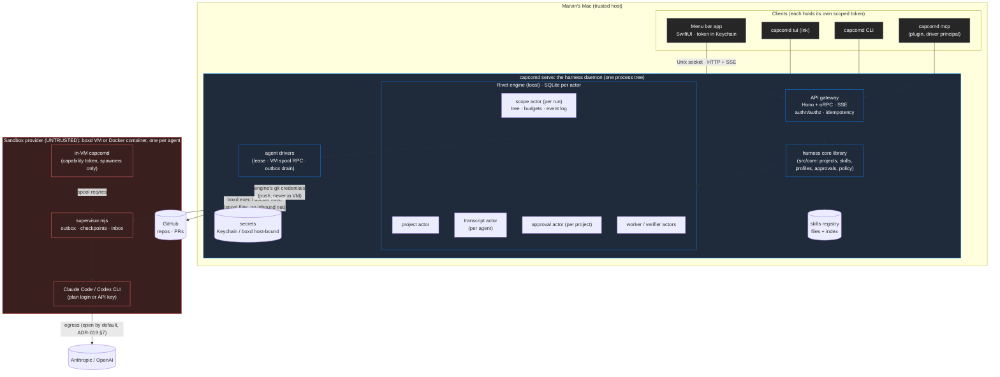

# Harness architecture: capcomd as one component of a swarm dev harness (draft)

Status: **draft for decision** (2026-10-24). Based on `main` at `b6d04e3` (ADR-016..020, `capcomd serve`, `capcomd tui`,
`capcomd setup`, `.capcomd/config.json` with named `run.checks`). Nothing here is built. Section 13 lists the decisions
Marvin needs to make.

## 0. One-paragraph summary

The harness is to multi-agent software work what the Grok Bot harness is to general assistant work. It holds the long-lived things
(projects, skills, profiles, transcripts, approvals), presents one versioned API and event stream to every client
(menu bar app, TUI, CLI, the plugin's MCP server), and delegates *execution* (sandboxes, agents, verify, merge,
budgets) to capcomd's primitives. The simplest shape that works: **one local daemon, `capcomd serve`, which already
hosts the Rivet engine. It also serves a Hono + oRPC API over a Unix socket (with loopback HTTP only for dev and
clients that can't use a socket), and it adds three actors (project, transcript, approval) beside the existing scope
actor.** The CLI, TUI and MCP server become clients of that API. The menu bar app is one more client, authenticated
by a per-client token in the Keychain. No new storage tier, no cloud dependency, and no message broker in v1.

## 1. Goals and non-goals

**Goals**
1. **Projects.** A goal that spans several repos or folders and holds many runs over time. This closes the
   menu bar spec's gap G1.
2. **Full-fidelity transcripts.** Every agent turn, text block, reasoning block, tool call, and tool result is paired by
   call id and stored without the 500-char cap (`src/agents/adapters.ts:80,113,186`). It is also redacted and bounded (G3).
3. **Skills registry.** Discover, version, and attach skills to `spawn` and to `send`, and pin them per profile (G2).
4. **Approvals and steering from a GUI**, with clear authority: who may approve what, under which token, and with an
   audit trail. Approvals bubble up the agent tree.
5. **One live event stream with a stable, versioned client contract.** It is resumable and backpressured. The menu
   bar app, TUI, and CLI read the same stream.
6. **Profiles, the agent tree, and budgets** are visible and editable through the same API, keeping ADR-017's
   narrow-only limits and ADR-019's optional limits.
7. **Every phase ships with regression evals** (section 11).

**Non-goals (v1)**
- Multi-user or hosted operation. This stays single host (ADR-004). Remote mode stays "not now" (ADR-018 §5).
- Replacing Claude Code or Codex with our own agent loop. We drive the provider CLIs and normalize their output.
  We don't re-implement tools (see Prior art, pi).
- A general workflow engine. Patterns stay in skills and orchestrators (ADR-016).
- Cross-machine sync of transcripts, a web UI, or mobile.
- Semantic search over transcripts. turbopuffer is a phase 5+ option, not v1 (section 12).

## 2. Prior art (read 2026-10-24, shallow clones)

| Harness | Commit read | Shape |
|---|---|---|
| **opencode** (sst/opencode) | `32b5701` | A Bun server with HTTP plus SSE, plus TUI, desktop, and web clients generated from one protocol package |
| **pi** (badlogic/pi-mono) | `38ff991` | A minimal agent loop library, with the coding agent run as a process in interactive, print, or RPC (JSONL over stdio) mode |
| **t3code** (pingdotgg/t3code) | `c79ef8c4` | A GUI over provider CLIs and SDKs, with a local server, desktop and web clients over WebSocket RPC, and an event-sourced orchestrator |

**opencode.**
- **Client/server split.** `packages/protocol/src/groups/*.ts` declares every route once (Effect HttpApi): session,
  message, permission, skill, event, project, worktree, and more. `packages/sdk` and the clients are generated from
  it.
- **Data model.** Session → Message → Part. `packages/schema/src/session-message.ts` has the tagged parts
  `text`, `reasoning`, `tool`, `shell`, `skill`, `compaction`, and others. A **tool part carries its own state machine** (`ToolState` =
  `streaming → running → completed | error`, with `input`, `content`, and `metadata`), so a call and its result are one
  record keyed by the call `id`.
- **Events.** `packages/schema/src/event.ts` defines each event type as `durable` (with an `aggregateID`, a per-aggregate
  `seq`, and a per-type schema `version`) or `ephemeral`. The `/api/event` SSE stream (`protocol/src/groups/event.ts`)
  is documented as *volatile*: "a slow consumer overflows and fails the stream, and events during disconnection
  are missed." Clients recover from durable reads.
- **Permissions.** `schema/src/permission.ts` has the replies `once | always | reject` and the saved rules
  `allow | deny | ask`. The routes are `POST /api/session/:id/permission/:requestID/reply` plus saved-rule CRUD.
- **Steering.** `schema/src/session-inbox.ts` has inbox items with `delivery: "steer" | "queue"`.

**pi.**
- **Agent loop.** `packages/agent/src/agent.ts` is a small loop with two queues: `steer`, delivered at the next tool
  boundary, and `followUp`, delivered when the run ends. Both are drained `one-at-a-time | all`, and the loop has an `AbortController` per run.
- **RPC mode.** `coding-agent/src/modes/rpc/rpc-types.ts` is a tiny command union over JSONL stdio: `prompt`, `steer`,
  `follow_up`, `abort`, `get_state`, `compact`, `bash`, and so on. Each command has an optional `id` to correlate the response.
- **Transcripts.** `coding-agent/src/core/session-manager.ts` stores sessions as append-only JSONL. Entries have
  `id/parentId`, which forms a tree for branching. It also has `compaction`, `model_change`, `usage`, and `custom` entries, plus versioned migrations.
- **Extensions.** `core/extensions/` loads TypeScript extensions (via jiti) that hook events and register tools and commands.
  `core/skills.ts` handles `SKILL.md` skills. The philosophy is deliberately few built-in tools and no built-in permission system.

**t3code.**
- **Server.** `apps/server` is the one process that owns provider sessions. The `desktop` (Electron), `web`, and `mobile`
  clients share `packages/contracts` (Effect Schema RPC over WebSocket, `WS_METHODS` in `contracts/src/rpc.ts`).
- **Provider adapters.** `orchestration-v2/Adapters/{Claude,Codex,OpenCode2,Pi,Acp,…}AdapterV2.ts` normalize each
  runtime. It uses the Claude Agent SDK and the Codex app-server rather than parsing CLI stdout.
- **Event sourcing.** `EventStore.ts`, `ProjectionStore.ts`, `EffectOutbox.ts`, and `CommandReceiptStore.ts` (idempotent
  commands) back the orchestrator. Live updates go through `ThreadLiveEventCoalescer.ts` and `LiveStreamBudget.ts`, which coalesce
  deltas and bound the stream.
- **Approvals.** `contracts/src/providerRuntime.ts` names the provider approval kinds
  (`command_execution_approval`, `file_change_approval`, `apply_patch_approval`, `mcp_elicitation_approval`, and others)
  and routes them to the UI.
- **Auth.** `apps/server/src/auth/` has `PairingGrantStore.ts` (bootstrap grants with scopes, a subject, and an expiry,
  and a desktop bootstrap token), `SessionStore.ts`, `RpcAuthorization.ts` (per-method scopes), and `dpop.ts`.
- **Checkpointing.** `CheckpointService.ts` and `CheckpointRollbackService.ts` capture and roll back checkpoints. Threads, projects, and worktrees are first-class.

**What we take, change, or leave out**

| Idea | Verdict | Why |
|---|---|---|
| One protocol package that generates the server, client SDK, and OpenAPI (opencode, t3code) | **Adopt**, with oRPC instead of Effect | It is the core of multi-client stability. oRPC is Marvin's stack and gives typed TS clients plus OpenAPI for the Swift app |
| Session/Message/Part with **tool state on the part** (opencode) | **Adopt** as Turn/Item | It pairs call and result by construction and maps directly to the thread UI (section 5.4) |
| Durable vs ephemeral event types, with per-aggregate `seq` and per-type `version` (opencode) | **Adopt** | capcomd already has a global `seq` plus `entitySeq`. Adding a `v` per type and marking deltas ephemeral is a small step |
| Volatile SSE that drops slow consumers, with recovery by re-reading (opencode) | **Adopt** | It is simpler than per-client buffering, and capcomd's `--since-seq` resume already works this way |
| `steer` vs `queue` delivery and `abort` (pi, opencode inbox) | **Adapt** | Claude under the supervisor reads stdin mid-run, so steer is possible (ADR-019 step 3). Codex `exec` can't take input mid-run, so it gets `queue` only and the API says so |
| JSONL tree transcripts with `parentId` (pi) | **Adapt** | We take append-only and versioned migrations. Branching is rejected: we fork with a new agent and branch (ADR-016 `handoff`) |
| Extensions that run arbitrary TS in the harness (pi) | **Reject** for v1 | That would be untrusted code in the process that holds tokens. Skills (markdown) plus profiles cover the need |
| Provider SDK and app-server adapters instead of parsing CLI output (t3code) | **Defer** | It would give richer approvals, but capcomd runs CLIs inside VMs with no host channel (ADR-017 §1). Revisit it per provider once the transcript contract exists |
| Per-tool permission prompts from the agent (`once/always/reject`, t3code approval kinds) | **Reject** for in-VM agents. **Adopt** the reply shape for harness gates | The VM is the boundary (ADR-019 §7), and agents run with permissions bypassed. Approvals gate *irreversible harness actions* such as merges to protected branches, budget raises, egress widening, and secrets |
| Pairing grants plus scoped per-method authorization (t3code) | **Adopt**, simplified | We use one scoped token per client in the Keychain and drop DPoP because a Unix socket with 0600 permissions is already the proof of possession |
| Full event-sourced orchestrator with projections, outbox, and command receipts (t3code) | **Already have** the parts we need | Rivet actors plus SQLite transactions plus idempotency keys (ADR-008) do this. Don't add a second store |
| Coalescing deltas plus a live-stream budget (t3code) | **Adopt** | The menu bar app shouldn't receive per-token events |

## 3. Components



**Legend.** Blue = trusted, holds secrets and git credentials. Red = untrusted, everything inside a sandbox, and
everything an agent writes, even after it reaches the daemon. Grey = clients, each with its own token and scopes.
Solid arrows = calls. Dotted arrows = file or spool transport. **Trust boundaries:** (1) the socket and token boundary
between clients and the daemon, (2) the exec-channel boundary between daemon and sandbox, where only files cross and the VM
has no route to the daemon, and (3) the content boundary: agent-written text is fenced (ADR-017 §4) wherever it
reaches another model or a UI action.

| Component | Responsibility | Boundary: it does NOT |
|---|---|---|
| **API gateway** (`src/api/`, new) | Transport, authentication, scope checks, idempotency-key replay, SSE fan-out, versioned schemas | Hold business rules. It calls the core |
| **Core library** (`src/core/`, grows) | Projects, skills resolution, profiles, approval policy, transcript normalization, and calls into ADR-016 primitives (`src/primitives/ops.ts`, `policy.ts`) | Know about HTTP or which client is calling, beyond a `Principal` |
| **Rivet actors** | Durable state and transactions: `scope` (exists), plus `project`, `transcript`, and `approval` (new) | Talk to clients directly |
| **Drivers** (exist) | Lease an agent, run the VM, drain the spool and outbox, and push branches | Decide policy. They ask the core |
| **Supervisor** (exists, ADR-019) | Liveness, checkpoints, inbox delivery, and now **raw transcript capture** to `transcript.jsonl` in the VM | Hold secrets or push |
| **Skills registry** | Index `SKILL.md` files from built-in, user, project, and plugin sources, with content hashes | Execute code |
| **Clients** | Render and send commands | Read SQLite or trace files directly. The TUI moves off `inspect --follow` stdout to the API in phase 2 |

## 4. How capcomd fits

capcomd is not replaced. It becomes **the execution kernel plus one client**.

| Stays in the CLI (thin client) | Moves into the daemon or core library |
|---|---|
| Argument parsing, human output, `--json` printing | All mutating logic. Today much of `src/cli/index.ts` calls actors directly; that becomes `client.<proc>()` |
| `setup`, `auth login` (interactive terminal), `env build` (long and local) | Projects, skills, transcripts, approvals (new) |
| `serve` (starts the daemon) | Event fan-out (replaces per-process polling in `events --follow` and `inspect --follow`) |
| `tui` (launcher) | Profile CRUD (`.capcomd/agents.json` is read and written through core, with the file staying the source of truth) |

- **The CLI remains a client of the same API.** Every CLI verb maps one-to-one to an oRPC procedure, and the existing
  `capcomd.v1`/`relay.v1` JSON envelopes are kept as the CLI's *output* contract (docs/output-contract.md). The
  harness API is versioned separately (`harness.v1`), so both can evolve.
- **No daemon, no CLI?** `capcomd mcp` already auto-starts the engine (ADR-018 §2), and the CLI does the same: it
  connects to the socket, and starts `serve` if nothing answers.
- **The in-VM path is unchanged.** VM agents keep the spool RPC and capability tokens (ADR-017). The driver translates
  spool requests into core calls with `Principal{kind:"agent", agentId, ops}`. A VM never talks to the API.
- **Principals** extend ADR-018 §4: `operator` (human client), `driver` (MCP plugin), `agent` (in VM), plus
  **`viewer`** (read-only clients). The enforcement stays in `ops.ts` and `policy.ts`.

## 5. Data model

IDs are prefixed, sortable, and immutable (the ADR-016 style). Keyed creates derive the id from the key (`k<hash>`), as they do today.

### 5.1 Entities

| Entity | ID | Key fields | Stored in |
|---|---|---|---|
| **Project** | `prj-…` | `title`, `goal`, `workspaces[]`, `defaults{profile, checks, target, approvals, budget?}`, `skills[]` (pinned), `status: active\|archived`, `createdAt` | project actor |
| **Workspace** | `wsp-…` | `projectId`, `kind: git\|folder`, `repo` (URL) or `path`, `defaultTarget`, `protected[]`, `checks{name→cmd}` (operator-named, overrides `.capcomd/config.json`), `role: primary\|secondary` | project actor |
| **Run** | `run-…` (exists) | `projectId` (new, nullable), `workspaceIds[]`, `label`, `budget`, `state`, `goal`, `checksSet` (frozen at `run new`) | scope actor |
| **Agent** | `agt-…` (exists) | `runId`, `parent`, `depth`, `profile`, `profileVersion`, `workspaceId`, `skills[{name, hash}]`, `limits`, `budget`, `status` (`pending\|running\|paused\|done\|failed\|cancelled\|handed-off`), `notice?` (idle/spinning/failing/quota) | scope actor |
| **Turn** | `trn-<agt>-<n>` | `agentId`, `n`, `role: user\|assistant\|system\|steer\|handoff`, `items[]`, `usage{in,out,cacheRead,usd,notional}`, `startedAt`, `endedAt`, `provider`, `model` | transcript actor |
| **Item** (part) | `itm-<agt>-<n>-<i>` | `type: text\|reasoning\|tool\|diff\|error\|handoff`. For `tool`: `callId`, `name`, `state: pending\|running\|completed\|error`, `input` (JSON, redacted), `output` (text/JSON, redacted, capped at 64 KB inline, else `blobRef`), `durationMs`, `exitCode?`. Also `truncated?`, `redactions[]` | transcript actor |
| **Approval** | `apr-…` | `projectId`, `runId`, `agentId` (requester), `kind: merge\|budget\|egress\|secret\|spawn_widen\|custom`, `subject` (for example `{ref, target, vfyId}`), `question`, `status: pending\|approved\|denied\|expired\|withdrawn`, `decidedBy{clientId, principal}`, `decidedAt`, `reason?`, `expiresAt?`, `idempotencyKey` | approval actor |
| **Skill** | `skl-<name>@<hash8>` | `name`, `description`, `source: builtin\|user\|project\|plugin`, `path`, `hash` (sha256 of content), `version?` (frontmatter), `appliesTo{providers?, profiles?}` | registry index (SQLite in the project actor or a small `skills.db`) |
| **Profile** | `name@v<n>` | ADR-015 §5 spec + `skills[]` + `description` + `icon?`. A version bumps on each edit, and agents record the version they ran with | `.capcomd/agents.json` (source of truth) plus a version log |
| **Budget** | (exists) per agent and run | `{usd, turns, wallSeconds}` allocation, spent, rollup. A grant is `AGENT_GRANTED`/`RUN_GRANTED` | scope actor |
| **Verification** | `vfy-…` (exists) | `ref`, `commit`, `target`, `check` (name) + `command` (resolved), `pass`, `judge?` | scope actor |
| **Event** | `(scope, seq)` | see section 6 | each actor's log, merged |
| **Client** | `cli-…` | `label` ("Menu bar on Marvin's Mac"), `scopes[]`, `createdAt`, `lastSeenAt`, `revoked` | daemon `clients.db` (token hash only) |

### 5.2 Relationships

`Project 1─* Workspace`, `Project 1─* Run`, `Run 1─* Agent` (a tree via `parent`), `Agent 1─* Turn 1─* Item`,
`Run 1─* Verification`, `Project 1─* Approval` (each referencing a run and an agent), `Profile 1─* Agent`, and `Skill *─* Agent`
(attached at spawn or send, recorded with its hash).

**Simplification:** a run without a project still works (`projectId: null`), and the app shows it under "Unfiled".
That keeps every existing script and test unchanged.

### 5.3 Approvals bubble up the tree

An approval is attached to the requesting agent. `pendingApprovals(agentId)` is computed as the agent's own plus all
descendants' approvals (one SQL query over the scope tree), so a collapsed ancestor shows the amber hand (SPEC §4.4). Who may *decide*:

1. **An operator client** with the `approve` scope, always.
2. **An ancestor agent**, only for kinds its profile lists in `children.approve` (new, narrow-only like other
   limits), and **never** for `merge` to a protected target, `secret`, or `egress`. Those stay human (ADR-018 §4). This
   is how a planner approves its worker's budget grant without waking Marvin.
3. **The driver (MCP)**, only when the project sets `approvals: "client-confirmed"` (exists).

### 5.4 Transcripts: capture, pairing, storage

- **Capture.** The supervisor already receives every CLI event line. It writes the raw lines unchanged to
  `transcript.raw.jsonl` in the VM. The runner drains them in the same exec it already uses for the outbox
  (no new calls, ADR-019 step 3). The 500-char cap applies only to the *log event* `text`. The transcript gets the
  full content.
- **Normalize in the daemon, not the VM.** The adapters (`src/agents/adapters.ts`) gain `toItems(rawLine, state)`:
  Claude `tool_use`/`tool_result` paired by `tool_use_id`, Codex `item.started`/`item.completed` paired by `item.id`.
  An orphan result becomes an `error` item with `reason: "unpaired"`, so it is visible and never silently dropped.
- **Storage.** The transcript actor keeps one per agent (SQLite: `turns`, `items`, `blobs`). Outputs over 64 KB go to a
  blob table with a hash, capped at 4 MB per item (`truncated:true` beyond that). Raw lines are kept for 7 days for
  re-normalization when an adapter improves.
- **Redaction** happens before anything is stored (section 8). The raw file is redacted too, before it leaves the VM drain.
- **Retention.** The default is to keep transcripts while the project is active. `archive` compacts items to summaries plus blob refs.
- **S2?** Not for v1. Per-agent actor SQLite is durable, transactional with the events, and already backed up
  (durability.md). S2 becomes the right choice if transcripts must outlive the laptop or sync across machines (section 12, option C).

## 6. Event contract (`harness.v1`)

### 6.1 Envelope

```jsonc
{
  "v": 1,                         // envelope version
  "id": "evt_01JB…",              // globally unique, sortable
  "scope": "run-mvhd…",           // stream: a run, a project ("prj-…"), or "daemon"
  "seq": 1842,                    // position in that scope's merged log (resume cursor)
  "entity": "scope:agt-k30…",     // source aggregate
  "entitySeq": 57,                // per-entity, gap-free (exactly-once dedupe key with entity)
  "type": "agent.turn.item",      // dotted, lower-case
  "typeVersion": 1,               // schema version of this type's data
  "durability": "durable",        // or "ephemeral" (deltas, heartbeats, never replayed)
  "ts": "2026-10-25T05:55:00.000Z", "epochMs": 1792900500000,
  "projectId": "prj-…", "runId": "run-…", "agentId": "agt-…",   // null when not applicable
  "data": { /* type-specific, redacted, agent text fenced as {untrusted:true, by:"agt-…"} */ }
}
```

- **Mapping from today:** `seq`, `entity`, `entitySeq`, `ts`, `epochMs`, and `agentId` already exist (output-contract.md). The
  new fields are `v`, `id`, `scope`, `typeVersion`, `durability`, and `projectId`. Existing upper-case types (`AGENT_SPAWNED`) are
  aliased to dotted names (`agent.spawned`) in `harness.v1`, and the CLI's `capcomd.v1` output stays as is.
- **Type families:** `project.*`, `run.*`, `agent.*` (spawned/started/notice/paused/granted/done/failed/cancelled),
  `agent.turn.started|item|item.delta|ended`, `approval.requested|decided|expired`, `verify.*`, `merge.*`, `task.*`,
  `kv.*`, `skill.attached`, `budget.*`, and `client.*` (for audit).

### 6.2 Versioning rules

1. Additive fields never bump anything. Removing or renaming a field bumps `typeVersion`, and the server emits **both** versions
   for one minor release when a client asks with `?accept=agent.turn.item@1`.
2. Envelope `v` bumps only on an envelope change. This is expected to be rare.
3. Unknown `type` → clients must ignore it. Unknown `durability` → treat it as ephemeral.
4. The contract is generated from the oRPC/Zod schemas into `docs/harness-contract.md` and a JSON Schema bundle that the
   Swift app codegens from. A contract test (like `tests/scenarios/contract.test.ts`) gates CI.

### 6.3 Subscribe, resume, snapshot

- `GET /v1/streams/:scope/events?after=<seq>` returns **SSE**, with the SSE `id:` = `seq`, so `Last-Event-ID` resumes natively.
- The first frame is `snapshot` (the same content as today's `inspect.snapshot`: status, tree, totals, pending approvals),
  unless `after` is given and still within retention. After that come events, and `tree` frames after each `agent.*`, as `inspect --follow` does today.
- **Dedupe** on `(entity, entitySeq)` across reconnects, as today. The known caveat (a late arrival can sort before an emitted
  seq) is fixed by assigning `seq` **at the merge point in the daemon**, which is one writer per scope stream, instead of by time ordering.
- `project` scope streams multiplex all of the project's runs. The menu bar subscribes to `daemon` (project list,
  approvals count) and to one `run` while drilled in.

### 6.4 Backpressure

- Ephemeral deltas (`agent.turn.item.delta`) are **coalesced** to at most 10 per second per agent, and only sent to clients that opt
  in (`?deltas=1`, used by an open thread view).
- Each SSE connection has a bounded buffer (1,000 frames or 4 MB). On overflow the server sends `{type:"stream.reset", seq}` and
  closes. The client reconnects with `after=<last durable seq>`, receives a fresh snapshot, and catches up. This is opencode's volatile model, made explicit.
- Item bodies over 16 KB are not inlined in events. The event carries `{itemId, size, preview}`, and the client
  fetches `GET /v1/items/:id`.

### 6.5 Redaction

The order of operations is redact, then store, then emit. The redaction step uses the patterns from ADR-015 §2 (`sk-ant-`, `sk-proj-`, `gh?_`, `github_pat_`, `bxd_`,
`bxds_`) plus the probe-env-value match. Redactions are recorded as `redactions:[{path, kind}]`, never with the value. Events never
carry kv values (as today), secrets, tokens, or env.

## 7. Client API

### 7.1 Transport: options

| Option | Shape | For | Against |
|---|---|---|---|
| **A (recommended)** | Hono + oRPC over a **Unix socket** at `~/.capcomd/harness.sock` (0600), plus an optional loopback HTTP on `127.0.0.1:<port>` for dev. **SSE** for streams | Socket permissions are the first auth factor. No port collisions (an issue already hit with the engine ports). Swift AsyncHTTPClient (URLSession cannot dial a Unix socket) and Bun both handle it. SSE resume via `Last-Event-ID` is free. OpenAPI from oRPC lets the Swift client be generated | SSE is one-way, so commands are separate POSTs (fine: that is also how idempotency works) |
| B | Same, but **WebSocket** for both commands and events (t3code) | One connection, lower latency for steering | Its own reconnect and resume protocol, harder to curl and debug, and no per-request HTTP semantics for idempotency or caching |
| C | Keep shelling out to the `capcomd … --json --follow` CLI (today's SPEC §1) | Zero new code | One process per subscription, no auth model, polling, and a Swift app parsing CLI output. It doesn't scale past the TUI |

Socket path (`src/api/socket.ts` harnessSocketPath; the server is wired into `capcomd serve` in phase 1): `--harness-socket <path>` > `CAPCOMD_HARNESS_SOCKET` > config `harness.socket` > `~/.capcomd/harness.sock` (so it can move into a macOS app-group container). Always created 0600 in a 0700 directory. The server ignores `Host` on the socket; clients should send `Host: localhost` (a hex-encoded socket path, as AsyncHTTPClient sends, is accepted too).

### 7.2 Authentication for the GUI process

- **Pairing.** `capcomd clients add --label "Menu bar" --scopes read,steer,approve` prints a one-time pairing code, valid for 5 min.
  Alternatively, the app runs `capcomd clients pair --app com.capcomd.menubar` itself, the first time, with the user confirming in the terminal.
  The daemon stores only `sha256(token)`, the scopes, and the label.
- **Storage.** The app stores the token in the **macOS Keychain** (access group limited to the signed app). The CLI uses
  `~/.capcomd/clients/cli.token` (0600). The plugin's MCP uses `${user_config}` sensitive storage (ADR-018).
- **Per request.** `Authorization: Bearer cct-client.<id>.<secret>` over the 0600 socket. The scopes are `read`, `steer` (send, cancel,
  pause, resume), `spawn`, `approve`, `admin` (profiles, skills, clients, projects). The `Principal` = `{kind: operator|driver|viewer,
  clientId, scopes}` is passed into core, so the policy is the same for every transport.
- **Revocation and audit.** `capcomd clients revoke <id>` takes effect on the next request and closes open streams. Every mutating call
  emits `client.action` with `clientId`. Approvals record `decidedBy.clientId`.
- **Why not subscription or API-key auth for the GUI?** Provider credentials belong to agents, not clients (SPEC open
  question 4). The GUI never sees them.

### 7.3 Procedures (oRPC, `harness.v1`)

| Group | Procedures |
|---|---|
| projects | `projects.list/get/create/update/archive`, `workspaces.add/remove/update` |
| runs | `runs.list({projectId})`, `runs.create({projectId, goal, profile?, budget?, checks?})`, `runs.get`, `runs.cancel`, `runs.pause/resume` |
| agents | `agents.tree({runId, root?})`, `agents.get`, `agents.spawn` (operator only), `agents.grant`, `agents.cancel` |
| transcripts | `transcripts.turns({agentId, after?, limit})`, `items.get({itemId})`, `transcripts.export({agentId, format: md\|jsonl})` |
| steering | `agents.send({agentId, text, skills?[], delivery: "steer"\|"queue"})`. It returns `{accepted, delivery}`, where the delivery is downgraded to `queue` with a `note` for Codex (ADR-019). Also `agents.interrupt({agentId})`, which stops the current turn, checkpoints, and leaves the agent `paused` |
| approvals | `approvals.list({projectId?, status})`, `approvals.decide({approvalId, decision: "approve"\|"deny", reason?})` |
| skills | `skills.list({query?, source?})`, `skills.get`, `skills.reindex` |
| profiles | `profiles.list/get/put/delete` (writes `.capcomd/agents.json`, validates via `capcomd.agents/v1`) |
| verify | `verify.run({runId, ref, check})` where `check` must be a name in the run's `checksSet` (operator-named checks, no raw commands from non-operators) |
| clients | `clients.list/revoke` (admin) |
| streams | `GET /v1/streams/:scope/events` (SSE) |

### 7.4 Idempotency

Every mutating procedure takes `Idempotency-Key` (a header, or `key` in the input), as the CLI's `--key` does today. Replay with the same
params returns the recorded result with `replayed:true`. Different params give `409 conflict`. Keys are scoped to `(clientId, procedure)` and kept for 24 h
(for approvals: for the approval's life). `approvals.decide` is also **compare-and-set** on `status=pending`. A second decision gets
`409 already_decided` with the first decision, so two clients (menu bar and TUI) can't both act.

## 8. Security

1. **Secrets never enter model context or the event stream.** Provider keys stay boxd host-bound placeholders where available (ADR-015 §3).
   On Docker, they are in the env (ADR-020), with the risk documented. Git credentials stay on the host, and the engine pushes. Client tokens are stored hashed.
   The redaction step (section 6.5) runs on every transcript and event before storage. A scrub test (`env build` style) runs in CI over recorded transcripts.
2. **Untrusted fencing everywhere agent text crosses a boundary.** ADR-017's `<<<untrusted:agt-…>>>` fences apply to text
   delivered to another agent. In the API, agent-authored strings carry `untrusted:true`. Clients render them as text (no
   markdown links that auto-open, no HTML), and **no client action is ever derived from agent text.** An approval
   question is produced by the harness from structured fields (`Merge fix/backfill into main?`), never written by the agent.
3. **Approvals for irreversible actions.** Merges to protected targets, egress or secret changes, and budget raises above the project cap are approvals. Deleting
   repos and force pushes are not exposed at all. Approval decisions need the `approve` scope and are CAS'd and audited.
4. **Skills are data.** Attaching a skill appends its markdown to the agent's prompt. Skills from a `project` source are hashed and shown in
   the attach event, and a changed hash on a pinned skill shows a notice. No executable extensions in v1.
5. **Operator-named checks only** (`run.checks`). Non-operators pick a name, and commands never come from agents (ADR-017 §2).
6. **Daemon surface.** The socket is 0600. Loopback HTTP is off by default, and when on it requires a token and rejects any `Origin` header
   (CSRF from browsers). There is no network listener beyond loopback.
7. **Known non-boundary.** As in ADR-018 §4, a driver agent with a shell on the same Mac can act as the operator. Scopes are guardrails, not
   containment, until remote mode.

## 9. Observability

- **Traces:** keep tracing-simple (ADR-010). Add `api.<procedure>` spans with `client.id` and `principal.kind`, and
  `transcript.normalize` spans with item counts and unpaired counts. The traceId stays `sha256("trace:"+runId)`.
- **Metrics** (derived from events, no new pipeline): time to first turn, turns per agent, unpaired tool calls, redactions,
  stream resets, approval wait time, and steer-to-ack latency.
- **`capcomd doctor`** gains harness checks: socket permissions, client tokens, registry index freshness, and transcript drain lag.
- Upstash or a hosted OTLP endpoint is not needed while the system is single host. Add them only with remote mode.

## 10. Evals

Each phase's exit criteria include regression evals in CI, on the fake provider with recorded fixtures, plus one live e2e per phase on boxd
(`scripts/mac-subagents-e2e.sh` lineage).

| Eval | Asserts |
|---|---|
| **contract** | Every procedure and event type validates against the published schema. Old-client fixtures still parse (both versions emitted) |
| **transcript fidelity** | Recorded Claude and Codex streams (`apps/tui/fixtures`, plus new captures) → every `tool_use` has exactly one result. No item text is truncated under 64 KB. A golden markdown export matches |
| **redaction** | Seeded secrets in tool output, env dumps, and diffs never appear in SQLite, events, blobs, or exports |
| **stream resume** | Kill the connection at random seqs and under overflow → the client converges to the same state as a never-disconnected client, with no duplicates by `(entity, entitySeq)` |
| **approvals** | Bubble-up to the root. The CAS race between two clients produces exactly one decision. Ancestors can't approve protected merges. Revoked clients get 401 |
| **steering** | Claude steer is delivered within a turn. Codex is downgraded to queue and delivered on the next spawn or handoff. Interrupt leaves a checkpoint |
| **chaos** | Existing killpoints, plus `api.decide.after_cas.before_event` and `transcript.drain.mid`, with audits: one decision and contiguous entitySeq |
| **swarm outcome** | The 3-broken-files fan-out e2e merges all three via named checks, run through the API instead of the CLI |

## 11. Build phases

| Phase | Ships | Exit criteria (all with the evals named) |
|---|---|---|
| **0. Contract first** (≈3 days) | `src/api/contract.ts` (oRPC + Zod), `harness.v1` envelope, generated `docs/harness-contract.md`, the event mapping from today's events | Contract eval green. The TUI's inspect adapter can parse the new envelope from a fixture |
| **1. Daemon API, read-only** | Hono + oRPC on the socket inside `capcomd serve`, client tokens, `runs/agents/tree` reads, SSE stream with resume and backpressure. The TUI switches to it | Stream-resume eval, contract eval. The TUI renders a live run via the API with no CLI subprocess |
| **2. Transcripts** | Supervisor raw capture, adapter `toItems`, transcript actor, redaction, `transcripts.*` | Transcript-fidelity and redaction evals. A live run shows full tool args and results for Claude and Codex |
| **3. Approvals + steering from the GUI** | Approval actor and kinds, bubble-up, `approvals.decide` CAS, `agents.send` steer/queue, `interrupt`. Menu bar app v0 (read, approve, steer) | Approvals, steering, and chaos evals. Marvin approves a protected merge from the menu bar and the audit shows his client id |
| **4. Projects + skills + profiles** | Project and workspace actors, multi-repo runs (one workspace per agent in v1), skills registry and attach on spawn and send, profile CRUD | Swarm-outcome eval across 2 repos in one project. A skill attached in the app appears (hashed) in the agent's prompt and transcript |
| **5. CLI as pure client** | Remaining CLI verbs go through the API. Direct actor calls removed from `src/cli` | The full existing test suite plus scenarios pass with the CLI talking only to the socket |

**Revisions (2026-10-25):**
- **Redaction happens on ingest in the daemon.** Every event, transcript item and blob passes the redactor before it is written; the in-VM scrub is best-effort only and never relied on.
- **`seq` is persisted per scope in the same transaction as the event write**, so a restart never reuses or skips a cursor. The stream-resume eval adds a daemon-restart killpoint (`api.stream.daemon_restart`): clients reconnect with their last seq and converge with no gaps or duplicates.
- **Swift transport:** AsyncHTTPClient over the Unix socket (URLSession can't dial a Unix socket); loopback HTTP on 127.0.0.1 plus a client token is the fallback.
- **Order after phase 1:** transcripts (2) and approvals/steering (3) run in parallel. Menu bar v0 is gated on approvals only, not on transcripts.

**Premature complexity, called out and not planned:** a message broker or S2 for local events (actors plus SSE suffice), turbopuffer
transcript search (grep plus SQLite FTS first), multi-user auth or OAuth, DPoP, a plugin/extension runtime, one agent across multiple
repos (give each agent one workspace and coordinate at the project level), provider SDK or app-server adapters, and transcript branching.

## 12. Big choices (≤3 options each)

**12.1 Where the API lives**
- **A (recommended): inside `capcomd serve`**, in the same process tree as the engine host and drivers. One thing to start, and it already exists and auto-starts.
- B: a separate `capcomd harnessd` next to the engine. Isolates crashes, but adds two processes, two lifecycles, and an extra hop.
- C: a hosted daemon (boxd VM, ADR-018 §5b). Always on, but needs remote auth and credential custody. It comes later, with the same API.

**12.2 Transcript storage**
- **A (recommended): transcript actor SQLite** (Rivet), transactional with events and covered by existing backups.
- B: append-only JSONL files per agent (pi's model). Simplest to read, but no transactions with events and its own retention code.
- C: S2 streams per agent. Durable off-box and replayable, but a cloud dependency for a local tool. Pick it with remote mode.

**12.3 Projects**
- **A (recommended): a project actor holding workspaces and run ids. A run keeps one primary workspace, and its agents each get one workspace.**
- B: project = one run (SPEC G1's interim). Zero work, but no history across runs and no multi-repo.
- C: agents that mount several repos at once. Powerful, but merge, verify, and checkpoint all become multi-repo. Premature.

**12.4 Transport.** A (Unix socket, HTTP + SSE, oRPC), as in section 7.1.

## 13. Decisions needed from Marvin

1. **API location:** embed the harness API in `capcomd serve` (recommended) or run a separate daemon?
2. **Transport:** Unix socket + HTTP/SSE with oRPC (recommended), or WebSocket RPC like t3code?
3. **GUI auth:** per-client scoped tokens, paired via `capcomd clients add` and stored in the Keychain (recommended). Which scopes does the menu bar get by default: `read, steer, approve`?
4. **Project model:** project actor with workspaces, one workspace per agent (recommended), or project = one run for v1?
5. **Transcript storage and retention:** transcript actor SQLite (recommended) with a 64 KB inline / 4 MB per item cap, raw lines kept 7 days, and transcripts kept while the project is active. Are those limits OK?
6. **Steering semantics:** accept that Codex can only `queue` (no mid-run steer) until a Codex app-server adapter exists, or prioritize that adapter?
7. **Who can approve:** human only for protected merges, secrets, and egress. May ancestor agents approve budget grants and spawn widening for their subtree via `children.approve`?
8. **Skills sources and trust:** built-in, user (`~/.capcomd/skills`), project (`.capcomd/skills`), and plugin. Should project skills need a one-time operator trust prompt per hash?
9. **Event contract naming:** rename to dotted lower-case types in `harness.v1` (keeping `capcomd.v1` CLI output unchanged), or keep upper-case types everywhere?
10. **Phase order:** contract → read API → transcripts → approvals/steer + menu bar v0 → projects/skills → CLI as pure client. Revised: transcripts and approvals run in parallel after phase 1, and menu bar v0 is gated on approvals only (section 11).
11. **Swift client codegen:** generate from oRPC's OpenAPI (recommended; committed as `openapi/capcomd.json`, checked in CI), or hand-write a small client against the JSON Schema bundle? Transport: AsyncHTTPClient over the Unix socket, loopback HTTP + token as fallback.
12. **Deferred items confirmed out of v1:** S2, turbopuffer, Upstash, remote mode, executable extensions, and multi-repo agents. Any of these you want earlier?
