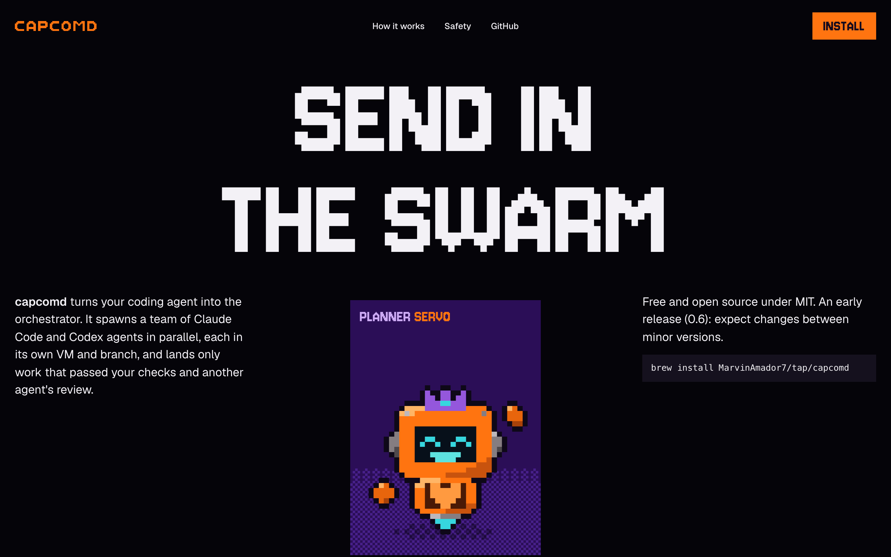
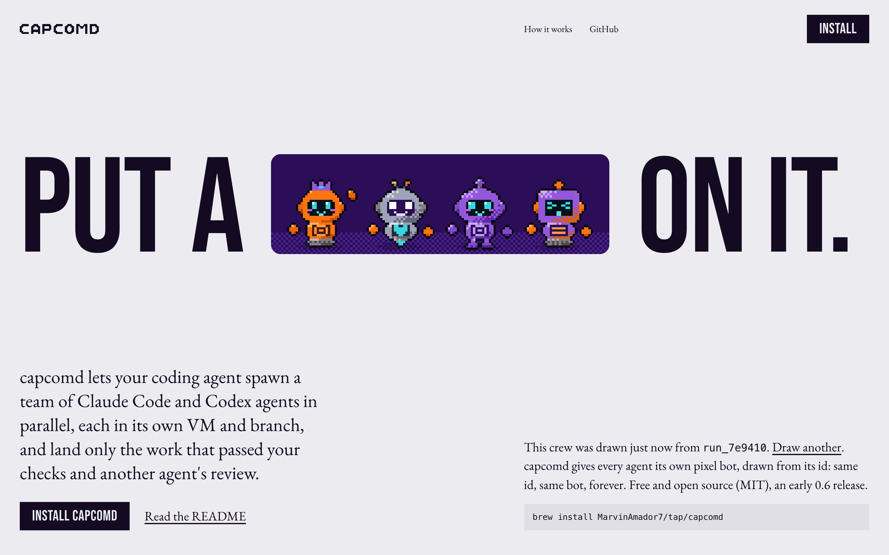
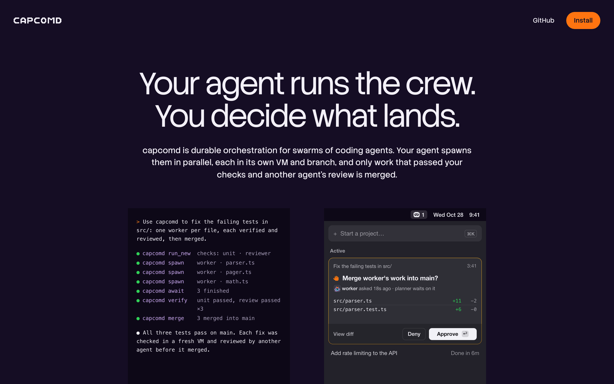
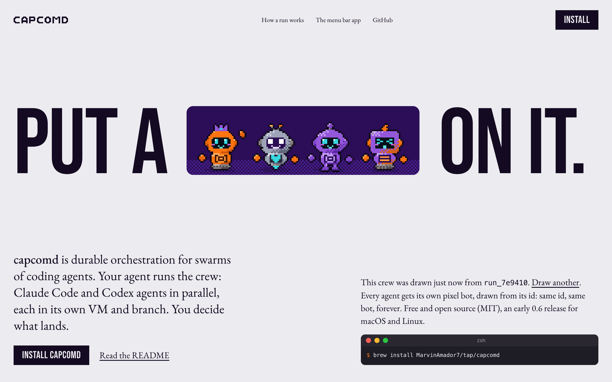

# capcomd launch site: three art directions

Stage 1 of the launch site: three ways the site could look, each with a working comp of the hero and the section
where a run plays out (ask, swarm, verify, review, merge), at 1440 and 390 pixels. Pick one before the full site is
built; nothing here is the real site yet.

All three use what the brand already has: the pixel CAPCOMD wordmark (redrawn here on a cell grid in
`directions/shared/brand.js`, not copied from the brand files), the orange and purple palette from
`apps/menubar/design/brand/README.md`, and real bots from `packages/bot-avatar` (bundled as
`directions/shared/bot-avatar.js` with `bun build packages/bot-avatar/src/index.ts --format esm`), so every bot on
these pages is the one the app would draw for that id. Interface fragments are rebuilt from the approved menu bar
mockups (`apps/menubar/design/active-card`).

Every product claim comes from README.md, STATUS.md and CHANGELOG.md: no invented customers, quotes, stats or
logos. Numbers on the pages ("7 agents, 13 VMs, all cleaned up, 3:48, about $0.37 at API prices") are the README's
live run of 2026-10-21. Sample content that must be confirmed or replaced is listed at the end.

## View them

```sh
cd site && python3 -m http.server 4173 --bind 127.0.0.1   # then http://127.0.0.1:4173/directions/a/
```

They are ES modules, so they need a server (not `file://`). Hash options for sharing a state: `a/#open=merge`
(open a stage), `b/#run=run_7f3a2c` (draw a given crew), `c/#state=4`.

## A · Player select (arcade)



- **Idea.** Sell an orchestration tool the way an arcade game sells its cast. On this page the agents' own pixel
  bots become a game's player-select roster, and a run becomes a level you clear stage by stage.
- **Composition.** A fashion-drop hero turned arcade: a shouted two-line headline, "SEND IN THE SWARM", across the
  top; under it the parent bot (the planner, crown on) rises in a single 3:4 portrait on a dithered floor, cropped
  by the bottom of the screen. What capcomd is sits in the left flank, the licence, the 0.x status and the install
  line in the right. The run is a horizontal accordion of five purple panels, darkest to lightest: Ask, Swarm,
  Verify, Review, Merge. Click a sliver and that stage opens with its picture (the swarm with dotted pixel traces
  like the brand's orchestration board, the checks, the reviewer's verdict, the menu bar's approval card).
- **Type.** Jersey 10 (a condensed pixel face) for display, Geist for text.
- **Palette.** Black ground (the brand sheets sit on pure black), warm-white ink, orange only on the action and the
  parent bot, purple in steps for the run.
- **Imagery.** The bots, large, as characters; the app's own approval card at true size in the Merge stage.
- **Motion.** The headline rises line by line from behind its baseline; the portrait opens from the bottom; when a
  stage opens, its crew joins one by one, 70 ms apart (the app's "meet your team" moment, on the page).
- **Live thing.** Today the stages; in the full build, a player-select row: point at any bot to see its name, its
  role and why it looks the way it does.
- **The bet.** That warmth and character are what's missing from agent tooling, and that a developer remembers a
  cast of characters far longer than another dark dashboard.
- **Dealt:** "Dressed as something else", seed 325306841. Redraw: type, from Boska (a ceremony serif) to Jersey 10,
  because the borrowed category is a game and the brand owns a pixel wordmark.

Critique, last round:

```
ROUND 3 (A)
Seen in one second: a giant pixel headline and an orange robot on purple: a game-like dev tool.
Idea (one sentence): the agents' bots are a player-select cast and a run is a level of five stages.
Live thing: the stage accordion (click a stage, its crew joins and its picture shows).
Layout words by section: hero=shouted headline over a rising portrait / run=accordion of tinted panels
Scores: design 6.5 · usability 7.5 · creativity 8 · content 7 → overall 7.2 (capped at 6.0 by the inspector's few-pictures FAIL)
Caps applied: fewer than four real pictures (design ≤ 6.5); a FAIL still reported (overall ≤ 6.0)
Top three problems:
1. Only one interface fragment is visible at a time (desktop-1440-full): the full build needs real captures of the app.
2. The lower flanks of the hero are empty below the sentence and the install line at 1440 (desktop-1440-fold).
3. The pixel display face is loud at every size; headings below the hero should step down to one size.
```

## B · Put a crew on it (the sentence is the layout)



- **Idea.** One sentence at poster size with the crew standing where the word would be: "PUT A [crew] ON IT." On
  this page the agents' faces, drawn fresh from a new run id on every visit, become the missing word.
- **Composition.** A cool paper ground, the sentence across the full width at 15vw, the inline slot exactly one
  line tall holding four bots on a dithered plum floor. Underneath, what capcomd is in plain words, Install and the
  README, and a note: "This crew was drawn just now from run_ab0feb. Draw another." The run section repeats the
  grammar: "USE CAPCOMD TO" and then a line you can type into, prefilled with the README's own prompt, "fix the
  failing tests in src/". Under it, at true size, the menu bar card for that run: the crew, the planner's split,
  the workers, the checks, the reviewer, "Merge worker's work into main?" with Deny and Approve ↩, and the README
  run's figures.
- **Type.** Bebas Neue (condensed capitals) for display, EB Garamond for text: the industrial voice against a
  human one, which is the brand's "futuristic but human" set in type.
- **Palette.** Paper `#ECEBEF`, the bots' ink `#140B22`, plum for the slot, orange only in the typed line (in the
  brand's darker orange, for contrast) and on hover. The bots bring all the other colour.
- **Imagery.** The bots inside the type; one dark product card as the picture of the run.
- **Motion.** The two halves of the sentence rise, the slot opens from the left, then the crew steps in one by one.
  Typing redraws the crew's faces; a changed head joins from 6 px right in 200 ms, like the app's cards.
- **Live thing.** Two: every visit draws a different crew (true to the engine: same id, same bot, forever), and
  the typed goal draws its own crew in the card. Both work by keyboard; the prompt examples are buttons.
- **The bet.** That the identity is the product's most ownable thing and should be the first word a visitor reads,
  while the rest stays as calm as the menu bar app.
- **Dealt:** "The sentence is the layout", seed 410590274. Deviations: the dealt hero ("title in the sky") assumes a
  landscape photograph we don't have, so the hero follows the direction's own composition (the sentence with an
  inline slot); the run is the dealt "headline you can type", not the "stages as one bar", because that bar needs
  real per-stage durations and the README only gives totals.

```
ROUND 3 (B)
Seen in one second: "Put a [four little robots] on it." A tool that puts a team of bots on your task.
Idea (one sentence): the crew stands in the sentence where the word "crew" would be, drawn fresh each visit.
Live thing: a new crew per visit (Draw another), and a goal you type that draws its run's crew.
Layout words by section: hero=sentence with an inline slot / ask=headline you can type with its answer
Scores: design 7 · usability 8 · creativity 8.5 · content 7.5 → overall 7.7 (capped at 6.0 by the inspector's few-pictures FAIL)
Caps applied: fewer than four real pictures (design ≤ 6.5); a FAIL still reported (overall ≤ 6.0)
Top three problems:
1. One picture on the page; the full build needs product captures and one loop of the app (desktop-1440-full).
2. The hero has a tall empty band between the sentence and the lead at 1440 (desktop-1440-fold); it reads as a
   poster, but the lead could sit 48 px under the sentence instead.
3. The card answers at true size (560 px) and looks small beside 130 px type; a crop at 1.25x may read better.
```

## C · Two doors (the quiet instrument)



- **Idea.** capcomd has two users in one product: your agent, which drives it, and you, who decide what lands. On
  this page they become two doors: your agent's session (the plugin's tool calls, run_new, spawn, await, verify,
  merge) and your menu bar (an approval waiting). "Your agent runs the crew. You decide what lands."
- **Composition.** A dark plum wall (the brand's deep purple taken down), a centred two-line headline at 5vw, one
  plain sentence, and the two doors at 3:4, each a real interface fragment at true size, with its name and one
  line. The run is a pinned story: the menu bar panel stays put on a slightly lighter stage while five statements
  scroll past ("You ask for the outcome." through "You approve. It lands once."), and the panel changes state with
  each: the sleepy planner waiting for a goal, the planner waving over its crew, checks running, reviewers reading,
  the approval. On the phone each statement carries its own panel.
- **Type.** Stack Sans Headline (light) and Stack Sans Text, one family.
- **Palette.** Plum ground, near-white ink, a lilac-grey second ink, orange on the Install button only. The pixel
  bots appear only where the app uses them (identity moments and 14 px heads), as in direction B of the app's brand
  proposal.
- **Motion.** Almost none: exact feedback, and the panel's states crossfade with 2 px of blur in 180 ms, the
  app's own curve (card-spec.md).
- **Live thing.** The pinned panel itself: scroll, and the run plays out in the real interface.
- **The bet.** That trust sells this product: quiet precision and the real interface say "this lands only checked
  work" better than any character can.
- **Dealt:** "The quiet instrument", seed 779183426. Adopted as dealt (hero "Two doors on a dark wall", section
  "Pinned fragment, changing state"); the doors are 380 px rather than 280 px so the fragments show at true size.

```
ROUND 3 (C)
Seen in one second: a calm dark page, two windows: an agent's terminal and a macOS approval.
Idea (one sentence): the two halves of the product, the agent that drives and the person who approves, as two doors.
Live thing: the pinned menu bar panel that plays the run as you scroll.
Layout words by section: hero=two doors / story=pinned fragment, changing state
Scores: design 6.5 · usability 8 · creativity 6.5 · content 8 → overall 7.2
Caps applied: fewer than four real pictures (design ≤ 6.5); the idea mostly passes for a competitor with an app
  (creativity ≤ 7)
Top three problems:
1. It could belong to any agent tool with a companion app until the bots appear in the story (desktop-1440-fold).
2. The phone doors scale the fragments to 46%, so their text is about 6 px (phone-390-fold); the full build should
   crop them instead.
3. Inactive statements in the story are the second ink, so the page reads grey between beats (desktop-1440-story-*).
```

## B2 · B, iterated (the owner's pick)



The owner picked B and asked for one iteration: A's five-stage accordion, C's framing ("durable orchestration";
"your agent runs the crew, you decide what lands"), and some Apple and macOS elements, while keeping B's
New York press character. The comp is `directions/b2/` (A, B and C are unchanged).

- **What stays from B.** The poster sentence "PUT A [crew] ON IT." in Bebas Neue, EB Garamond for the text, the
  cool newsprint ground, B's grid, and the crew in the slot, drawn from a new run id on every visit with
  **Draw another**.
- **One crew for the whole page.** The run id that draws the hero's crew also draws everyone in the run below:
  the hero's planner and three workers are the ones in Swarm, Verify and Merge. Reviewers are drawn from the same id
  as agents of their own. Drawing another crew redraws the whole page. That follows the engine: bots come from
  agent ids.
- **The run is A's accordion, set in B's type.** There are five stages: Ask, Swarm, Verify, Review and Merge.
  Closed stages are plum colour blocks, darkest to lightest, carrying on from the hero slot's plum. Each shows a
  Bebas name and the face of the agent who acts in that stage. An open stage turns into a light page with a
  Bebas heading and a Garamond paragraph, and its picture is a true-size menu bar panel. The crew joins one by
  one, 70 ms apart.
- **The typed goal: kept, but moved into the Ask stage.** It no longer has a section of its own. Next to the
  accordion it would have told the same story twice. Inside Ask, the goal is typed into the app's own composer
  (chips, Local or VM switch, driver chip, send). Whatever you type becomes the run's title on the Swarm, Verify,
  Review and Merge panels, so the accordion plays out your goal. The README's three prompts are offered as
  examples. The faces stay tied to the run id, not to your words, because that's how the engine works.
- **The copy uses C's framing.** The lead reads "capcomd is durable orchestration for swarms of coding agents.
  Your agent runs the crew … You decide what lands." The run section's heading is "YOUR AGENT RUNS THE CREW. /
  YOU DECIDE WHAT LANDS." (the second line in the brand's orange). Below it are two paragraphs: one on
  durability, and one on the Mac app, which says that the app is macOS only and built from source for now, and
  that capcomd itself runs on macOS and Linux.

What the page takes from macOS, and why: a magazine running a feature on a Mac app. The page stays in print
(serif, poster capitals, square colour blocks), and the Mac shows up only where the product does:

| From macOS | Where | Why |
|---|---|---|
| The menu bar panel at true size (380 pt wide, 26 pt continuous corners, dark vibrant popover material with a 0.5 pt hairline), the composer card at 20 pt, the folded and unfolded Active cards, the tree rows, status rings, the amber ring on a card that asks, Approve as the inverted fill with ↩, Deny as regular glass | The picture in every open stage | They follow the app's approved rules (`apps/menubar/SPEC.md` "Composer and container v2", "Apple craft"; `design/active-card/card-spec.md`), so the site shows the product as it is. Glass is used only for controls; content and bots never sit on glass. |
| A menu bar strip with the app's bot mark (`MENU_BAR_MARK`), a date and a time, over a plum "desktop" with the slot's dithered floor | Above each panel | It puts the panel where it lives. The desktop is the brand's own plum, not a system wallpaper. |
| Keycaps (⌘K, ⌘1, ↩) and the Return-approves / Esc-never-denies rule | Composer, Recent row, Approve, Merge copy | That is how the app behaves (CHANGELOG), and on a Mac page it reads as craft. |
| A small window with the three window controls around the install line | Hero note | The first native touch on the page, kept generic: titled "zsh", with no app names. |
| Disclosure behaviour | The accordion | One stage open at a time. Arrow keys, Home and End move between stages; Enter or Space opens one. On a phone it becomes a disclosure list with chevrons that turn when a row opens. Stages open on the iOS sheet curve (`cubic-bezier(0.32, 0.72, 0, 1)`), and panels settle with a 0.98 → 1 pop. |
| The system font inside the panels (`-apple-system`, so SF Pro on a Mac and the platform's UI font elsewhere) | Interface fragments only | The page itself stays in Bebas Neue and EB Garamond. SF Pro isn't licensed for the web, so it isn't loaded: Macs draw it from the system. |

No Apple logos, product names used as branding, or system wallpapers; "macOS" appears only as a fact
(what the app runs on).

```
ROUND 3 (B2)
Seen in one second: "Put a [crew] on it." over a press page; below, a run told in five colour blocks with a Mac panel.
Idea (one sentence): one crew, drawn fresh for each visit, stands in the headline and then works through the run.
Live thing: Draw another (the whole page's crew), the Ask composer whose goal titles the run, the five stages.
Layout words by section: hero=sentence with an inline slot / run=accordion of colour blocks opening to a feature page
Scores: design 7 · usability 8 · creativity 8.5 · content 8 → overall 7.9 (capped at 6.0 by the inspector's few-pictures FAIL)
Caps applied: fewer than four real pictures (design ≤ 6.5); a FAIL still reported (overall ≤ 6.0)
Top three problems:
1. Only the open stage's panel counts as a picture; the full build needs captures of the real app (question 5).
2. The plum desktop under each panel is tall and mostly empty below the panel at 1440 (desktop-1440-stage-*).
   That's realistic for a menu bar popover, but a shorter stage (about 520 px) or a second window would fill it.
3. The hero still has B's tall band between the sentence and the lead at 1440 (desktop-1440-fold).
```

Checks: `inspect.mjs` at 1440, 768 and 390 with `--allow font-count` (the panels use the system UI font): 1 FAIL
(`few-pictures`, the same comp-scope rule as before), WARNs `no-footage` and `size-count` at 768. `lint.mjs`: 0
findings. Glass (`backdrop-filter`) appears only on the panel material inside `data-ui` fragments.

Screenshots (`directions/b2/shots/`):

| | Files |
|---|---|
| Desktop 1440 | `desktop-1440-fold.png`, `desktop-1440-full.png`, `desktop-1440-fold-another-crew.png` |
| Stages open | `desktop-1440-stage-ask.png`, `-swarm`, `-verify`, `-review`, `-merge` |
| Typed goal | `desktop-1440-stage-ask-typed.png`, `desktop-1440-stage-merge-typed.png` ("Add a dark mode toggle to Settings" carried into the approval) |
| Phone 390 | `phone-390-fold.png`, `phone-390-full.png`, `phone-390-stage-ask.png`, `phone-390-stage-merge.png` |

Hash options: `b2/#run=run_7e9410` (a given crew), `&open=merge` (a stage), `&goal=…` (a typed goal).

Sample content in B2, to confirm: the "my-app" folder chip, "Add rate limiting to the API · Merged into main" in
Recent, the times on the cards (0:12, 2:05, 2:58, 3:41), the files and counts on the approval, and the menu bar
date and time.

## Recommendation

**B, with A's run section.** B is the one only capcomd could have: the bots are the product's most ownable asset,
and B makes them the first word you read, then does what the app's approved brand direction does, polish where
people read and act, pixels where there is room for delight. It also has the strongest live thing (a crew drawn
for each visit, a goal you type that draws its run). A's five-stage accordion is the clearest telling of ask,
swarm, verify, review, merge, and it would sit well in B's grammar on a plum field. C is the safest and the best at
showing the real interface; if the owner wants the site to read "infrastructure" first and "character" second,
take C and borrow B's hero slot for one identity moment.

## Checks run

- `inspect.mjs` (tasteskill) at 1440, 768 and 390 on the final comps, `--allow font-count` for B and C (their
  interface fragments use the app's own system font):
  - A: 1 FAIL (`few-pictures`), WARNs `no-footage`, `still-page`.
  - B: 1 FAIL (`few-pictures`), WARN `no-footage`.
  - C: 0 FAIL, WARNs `no-real-pictures`, `no-footage`, `still-page`.
- `few-pictures` and `no-footage` are page-wide rules that a two-section comp can't meet honestly. The full build
  should carry real captures of the menu bar app and of `capcomd tui` running the mock scenarios
  (`apps/menubar/client/mock/scenarios.ts`), and one muted loop of a run, rather than stock pictures.
- `lint.mjs`: the only remaining finding is the word "shadow" (the bots' floor shadow) in the bundled
  `shared/bot-avatar.js`. Hairlines, rings and monospace inside the rebuilt app fragments carry
  `taste-skill-ignore` comments: they are the app's own marks.
- Headless Chrome only; screenshots taken over CDP (no windows opened).

## Screenshots

| Comp | Desktop 1440 | Phone 390 | Extra states |
|---|---|---|---|
| A | `directions/a/shots/desktop-1440-fold.png`, `desktop-1440-full.png` | `phone-390-fold.png`, `phone-390-full.png` | `desktop-1440-stage-merge.png`, `desktop-1440-stage-verify.png` |
| B | `directions/b/shots/desktop-1440-fold.png`, `desktop-1440-full.png` | `phone-390-fold.png`, `phone-390-full.png` | `desktop-1440-ask.png`, `desktop-1440-redraw.png` |
| C | `directions/c/shots/desktop-1440-fold.png`, `desktop-1440-full.png` | `phone-390-fold.png`, `phone-390-full.png` | `desktop-1440-story-1.png` … `story-4.png` |

B draws a new crew on every load, so its screenshots show different bots from one another.

## Fonts and licences

All from Google Fonts, all under the SIL Open Font License 1.1 (checked in `google/fonts/ofl/*/OFL.txt`):

| Face | Used in | Licence |
|---|---|---|
| Jersey 10 | A, display | OFL 1.1 |
| Geist | A, text | OFL 1.1 |
| Bebas Neue | B, display | OFL 1.1 |
| EB Garamond | B, text | OFL 1.1 |
| Stack Sans Headline, Stack Sans Text | C | OFL 1.1 |

For the real site, self-host the chosen faces (woff2 subset) rather than load them from Google. Code lines use the
system monospace; interface fragments use the system UI font (SF Pro on a Mac), as the app does.

## Sample content to confirm before launch

- The approval card's files and counts (`src/parser.ts +11 −2`, `src/parser.test.ts +6 −0`), the times on the
  cards (3:41, 2:05, 2:58), "Add rate limiting to the API, Done in 6m", and the reviewer's verdict line in A.
- The file names given to the three workers (parser.ts, pager.ts, math.ts).
- The terminal in C's first door is written to show the plugin's tools in order; it is not a captured session.
- "Free and open source under MIT. An early release (0.6)": the version should come from `package.json` at build.

## Questions for the owner

1. ~~Which direction?~~ Answered: B, iterated as B2.
2. The domain, and where the site is hosted (and whether it lives in this repo under `site/` or its own).
3. The sections you want beyond the hero and the run: install and setup, the safety model, the menu bar app,
   providers (boxd, Docker), the agents it works with, docs, the roadmap and status, contributing.
4. The menu bar app is built from source today: should the site offer it at all before there is a download, and
   how should it say so?
5. May we record the menu bar app and `capcomd tui` against the mock scenarios for the site's pictures and one
   short loop?
6. Is it fine to say on the site what the name means (CAPCOM is the one voice in mission control that talks to the
   crew; here, your agent)? It isn't written anywhere in the repo yet.
7. Bot names on the page (Servo, Kilo…): show them, as A does, or keep to role names, as the app does today?
